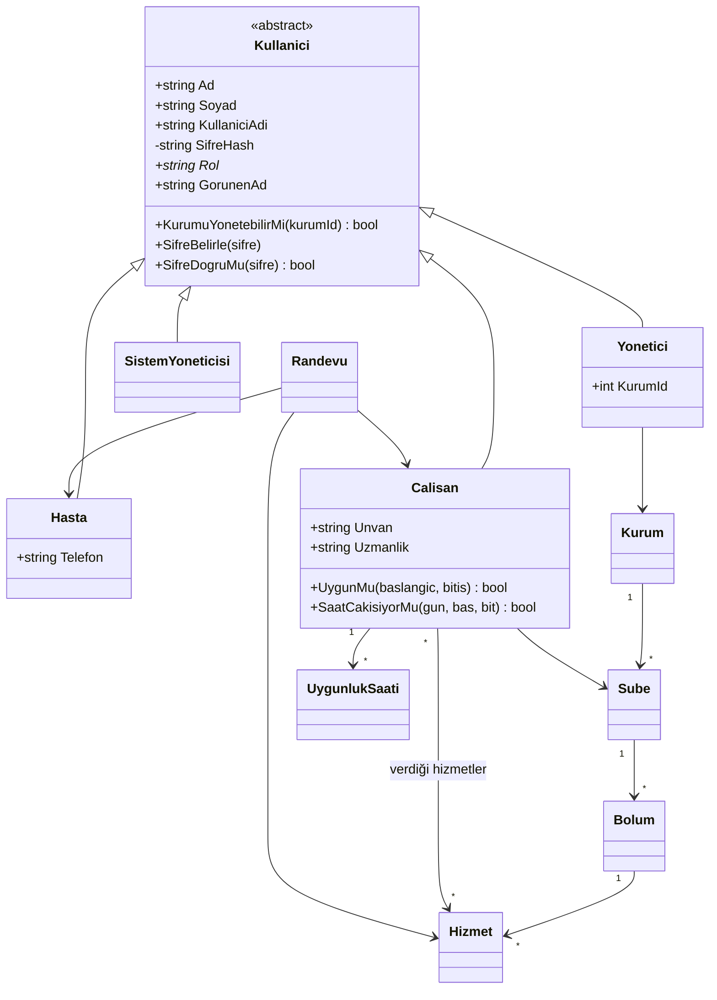

# Hastane / Klinik Randevu Sistemi – Proje Raporu

Nesneye Dayalı Programlama dersi, proje ödevi (Seçenek A)

## 1. Konu seçimi

Ödevde iki seçenek vardı: ya bir makale incelemesi ya da hastane/klinik randevu sistemi uygulaması.
Ben uygulamayı seçtim. Makale okuyup yorumlamak yerine sınıfları, kalıtımı, çok biçimliliği
gerçekten bir şeyin içinde kullanmanın konuyu daha iyi oturtacağını düşündüm. Randevu sistemi de
buna uygun bir konu çünkü içinde birbirinden farklı ama ortak yanları olan birçok nesne var
(hasta, doktor, yönetici, kurum, şube, hizmet, randevu...).

## 2. Kullandığım teknolojiler

- C# ve ASP.NET Core MVC (.NET 10)
- Entity Framework Core, veritabanı olarak SQLite
- Arayüz için Bootstrap
- Sürüm takibi için Git ve GitHub

Veritabanı olarak SQLite seçmemin sebebi kurulum gerektirmemesi. Proje ilk çalıştığında
`hastane.db` dosyasını kendisi oluşturuyor ve içine örnek veri ekliyor. Böylece projeyi açan
kişi ayrıca bir veritabanı kurmak zorunda kalmıyor.

## 3. Projeyi nasıl geliştirdim

İlk olarak işin mantığını oturtmak için Python ile konsolda çalışan basit bir sürüm yaptım.
Sınıfları orada tasarlayıp randevu alma, onaylama, çakışma kontrolü gibi kuralları denedim.
Programı denerken elle veri girmek çok uzun sürdüğü için içine örnek hastalar, doktorlar ve
randevular ekledim. Bu sayede kuralların doğru çalışıp çalışmadığını hemen görebildim. Örneğin
burada iptal edilmiş ya da reddedilmiş randevuların hâlâ saati dolu gösterdiğini fark ettim ve
çakışma kontrolünü sadece aktif randevulara bakacak şekilde düzelttim.

Mantık oturduktan sonra projeyi web sitesine taşımaya karar verdim ve ASP.NET Core MVC ile
baştan yazdım. Sınıf yapısı ve kurallar aynı kaldı, sadece arayüz web sayfası oldu. İlk web
sürümünü fazla kapsamlı yaptım; çok fazla özellik ve ayrıntı vardı, bir kısmını açıklamakta
bile zorlanacağımı fark ettim. Bu yüzden projeyi sadeleştirdim, gereksiz özellikleri çıkarıp
ödevde istenenlere odaklandım. Kodun da okunabilir olmasına, açıklama satırlarının yerinde
olmasına dikkat ettim.

Sadeleştirdikten sonra ödev dökümanındaki maddeleri tek tek kontrol ettim ve bazı eksikler
gördüm:

- Tek bir yönetici vardı. Her kurumun ayrı bir yöneticisi olacak şekilde değiştirdim. Bir kurum
  yöneticisi artık başka kurumun bilgilerini göremiyor.
- Her şeyi yönetebilen bir üst düzey yönetici (admin) rolü ekledim. Kurum ekleme ve silme sadece
  admin'de var. Kurum yöneticisi şube, hizmet ve çalışan silebiliyor ama kurum silemiyor.
- Doktorun aynı saatte iki randevusu olmaması için çakışma kontrolünü sağlamlaştırdım. Ayrıca
  çalışma saati girerken de aynı gün çakışan iki saat aralığı girilemiyor.
- Eklenen kayıtlar için düzenleme ve silme sayfaları ekledim.

Projeyi GitHub'a aşama aşama yükledim. Her aşama kendi başına derlenip çalışıyor; önce boş MVC
projesi, sonra sınıflar, sonra veritabanı, giriş sistemi, yönetim paneli, randevu alma ve en son
admin paneli geldi. Toplam 11 commit var.

## 4. Sınıf yapısı

Projenin merkezinde `Kullanici` sınıfı var. Sistemdeki dört kullanıcı türü de bundan türüyor.



Kurum tarafı ise iç içe bir yapıda: bir **kurum** (hastane ya da klinik) şubelerden, her **şube**
bölümlerden, her **bölüm** de hizmetlerden oluşuyor. **Hizmet** sınıfında süre (dakika) ve ücret
tutuluyor. Hastanenin birden fazla şubesi olabiliyor, kliniğin ise tek şubesi oluyor. Bu kuralı
`Kurum.SubeEklenebilirMi()` metodu kontrol ediyor. Böylece hem tek şubeli hem çok şubeli
kuruluşlar desteklenmiş oluyor.

**Çalışan** sınıfını hem doktorlar hem diğer sağlık personeli için kullandım. Aradaki farkı
`Unvan` alanı gösteriyor ("Uzm. Dr.", "Hemşire", "Dt." gibi). Her çalışanın bir uzmanlık alanı,
verdiği hizmetler (çoka çok ilişki) ve haftalık çalışma saatleri (`UygunlukSaati`) var.

## 5. Kullandığım NDP kavramları

**Kalıtım ve soyut sınıf:** `Kullanici` abstract bir sınıf, yani doğrudan nesnesi oluşturulamıyor.
Ortak alanlar (ad, soyad, kullanıcı adı, şifre) bir kere yazıldı, `Hasta`, `Calisan`, `Yonetici` ve
`SistemYoneticisi` bunları miras alıyor. Veritabanında da tek tabloda tutuluyorlar, Entity
Framework hangi satırın hangi sınıfa ait olduğunu kendisi ayırt ediyor.

**Çok biçimlilik:** Bence projenin en işe yarayan kısmı burası. Yetki kontrolünü her yerde
`if (rol == "admin") ... else if (rol == "yonetici") ...` şeklinde yazmak yerine `Kullanici` sınıfına
bir metot koydum ve alt sınıflar onu kendine göre değiştiriyor:

```csharp
// Kullanici: normalde hiçbir kurumu yönetemez
public virtual bool KurumuYonetebilirMi(int kurumId) { return false; }

// Yonetici: sadece kendi kurumunu
public override bool KurumuYonetebilirMi(int kurumId) { return KurumId == kurumId; }

// SistemYoneticisi (admin): hepsini
public override bool KurumuYonetebilirMi(int kurumId) { return true; }
```

Yönetim sayfasındaki her işlemde sadece `kullanici.KurumuYonetebilirMi(kurumId)` çağrılıyor,
giriş yapan kişi hangi sınıftansa onun metodu çalışıyor. Bunun dışında `Rol` özelliği her alt
sınıfta farklı değer döndürüyor, `GorunenAd` özelliği de `Calisan` sınıfında unvanı ekleyecek
şekilde override edildi (örneğin "Uzm. Dr. Ayşe Yılmaz").

**Kapsülleme:** Randevunun durumu dışarıdan doğrudan değiştirilemiyor (`private set`). Durum sadece
`Onayla()`, `Reddet()` ve `IptalEt()` metotlarıyla değişiyor ve bu metotlar kuralları kendi içinde
kontrol ediyor. Örneğin reddedilmiş bir randevu sonradan onaylanamıyor. Şifreler de açık şekilde
tutulmuyor, `SifreBelirle()` metodu şifreyi SHA256 ile özetleyip saklıyor; `SifreHash` alanı da
dışarıdan değiştirilemiyor.

**MVC yapısı:** Sınıflar `Models` klasöründe, sayfalar `Views` klasöründe, ikisini bağlayan işlemler
`Controllers` klasöründe. Randevu kurallarını controller'ın içine yazmak yerine ayrı bir
`RandevuServisi` sınıfına koydum, böylece aynı kontroller hem randevu alırken hem boş saatleri
listelerken kullanılabiliyor.

## 6. Randevu alma ve çakışma kontrolü

Hasta önce hizmeti, sonra o hizmeti veren doktoru ve günü seçiyor. Sistem o gün için 15 dakika
aralıklarla boş saatleri listeliyor, hasta da bunlardan birini seçiyor. Listelenen her saat ve
kaydedilmeden önce seçilen saat şu kontrollerden geçiyor (`RandevuServisi.Kontrol()`):

1. Geçmiş bir saate randevu alınamaz.
2. Seçilen çalışan bu hizmeti veriyor olmalı.
3. Şube o saatte açık olmalı (Pazar günleri kapalı).
4. Çalışan o saatte çalışıyor olmalı, yani saat çalışanın uygunluk saatlerinin içinde kalmalı.
5. Çalışanın o saatte başka bir randevusu olmamalı.
6. Hastanın da o saatte başka bir randevusu olmamalı.

İki zaman aralığının çakışıp çakışmadığını `Randevu.CakisiyorMu()` metodu kontrol ediyor. İptal
edilen veya reddedilen randevular saati boşaltıyor, yani çakışma sayılmıyor.

Randevu kaydında işlem (hizmet), süre (başlangıç ve bitiş), ücret, çalışan, hasta ve tarih/saat
tutuluyor. Ücret, randevu alındığı andaki hizmet ücretinden kopyalanıyor; böylece hizmetin ücreti
sonradan değişse bile eski randevuların ücreti bozulmuyor.

Yeni randevu "Onay Bekliyor" durumunda oluşuyor. Doktor kendi randevularını, kurum yöneticisi de
kendi kurumunun randevularını onaylayabiliyor veya reddedebiliyor. Hasta da randevusunu iptal
edebiliyor.

## 7. Roller

| İşlem | Admin | Kurum yöneticisi | Doktor / Personel | Hasta |
|---|---|---|---|---|
| Kurum ekleme, düzenleme, silme | ✓ | | | |
| Kurumlara yönetici atama | ✓ | | | |
| Şube, bölüm, hizmet ekleme/düzenleme/silme | ✓ | ✓ (kendi kurumu) | | |
| Çalışan ve çalışma saati yönetimi | ✓ | ✓ (kendi kurumu) | | |
| Randevu onaylama / reddetme | ✓ | ✓ (kendi kurumu) | ✓ (kendi randevuları) | |
| Randevu alma ve iptal | | | | ✓ |

Ödevde en az üç rol isteniyordu (hasta, doktor/personel, kurum yöneticisi). Ben bunlara
dördüncü olarak admin rolünü ekledim. Giriş sistemi için ASP.NET'in cookie tabanlı oturum
yapısını kullandım; her controller'ın başında hangi rollerin o sayfaya girebileceği yazıyor,
yetkisi olmayan biri girmeye çalışırsa uyarı sayfasına yönlendiriliyor.

## 8. İsterlerin karşılanması

| Ödevdeki ister | Projede nerede |
|---|---|
| Hastane/klinik yetki çerçevesinde tanımlanabilmeli | Kurumları sadece admin ekleyebiliyor, şubeleri kurum yöneticisi |
| Tek ve çok şubeli kuruluş desteği | `Kurum` → `Sube`, `SubeEklenebilirMi()` |
| Çalışma saatleri ve bölümler | `Sube.AcilisSaati / KapanisSaati`, `Bolum` sınıfı |
| Hizmetlerin süresi ve ücreti | `Hizmet.SureDakika`, `Hizmet.Ucret` |
| Doktor ve personel kaydı | `Calisan` sınıfı, `Unvan` alanı |
| Uzmanlık alanı ve verilen hizmetler | `Calisan.Uzmanlik`, `Calisan.Hizmetler` |
| Uygunluk saatleri, randevu sadece bu saatlerde | `UygunlukSaati`, `Calisan.UygunMu()` |
| Çakışma kontrolü | `RandevuServisi.Kontrol()`, `Randevu.CakisiyorMu()` |
| Randevu detaylarının kaydı | `Randevu` sınıfı (hizmet, süre, ücret, çalışan, tarih/saat) |
| Onay mekanizması | `Onayla()`, `Reddet()`, doktor ve yönetici panelleri |
| En az üç rol | Hasta, Doktor/Personel, Kurum yöneticisi + Admin |
| GitHub'da en az 10 commit | 11 commit |

## 9. Örnek veriler

Projeyi deneyen kişi boş bir sistemle karşılaşmasın diye ilk açılışta örnek veriler ekleniyor:
iki şubeli "Sakarya Şifa Hastanesi", tek şubeli "Gülüş Diş Kliniği", 7 çalışan, 15 hasta ve
bugünden önceki ve sonraki iki haftaya dağılmış rastgele randevular. Deneme hesaplarının kullanıcı
adları ve şifreleri README dosyasında yazıyor.

## 10. Eksikler ve geliştirilebilecek yönler

- Hastalara randevu hatırlatması (e-posta veya SMS) gönderilmiyor.
- Şubelerin çalışma saati her gün için aynı; cumartesi yarım gün gibi farklı saatler girilemiyor.
- Doktorların izin günleri ayrıca girilemiyor, sadece haftalık çalışma saatleri var.
- Raporlama kısmı yok. Örneğin bir doktorun aylık randevu sayısı veya kurumun kazancı
  gösterilebilir.
- Veritabanı SQLite olduğu için gerçek bir hastanede kullanılacaksa SQL Server gibi bir
  veritabanına geçmek gerekir.

## 11. Sonuç

Bu projede NDP konularını, sadece tanımlarını bilmek yerine, bir uygulamanın içinde neden
kullanıldıklarını görerek öğrendim. Özellikle yetki kontrolünü çok biçimlilikle çözmek, her yere
uzun if-else blokları yazmaktan çok daha temiz oldu; yeni bir rol eklemek istediğimde sadece yeni
bir alt sınıf yazmam yetiyor. Randevu durumunu kapsüllemek de hatalı durum geçişlerini (reddedilen
randevunun onaylanması gibi) baştan engelledi. Projeyi önce Python ile deneyip sonra web'e taşımak
da işime yaradı, çünkü web tarafına geçtiğimde kurallar zaten oturmuştu.

Çalıştırma adımları ve deneme hesapları için `README.md` dosyasına bakılabilir.
